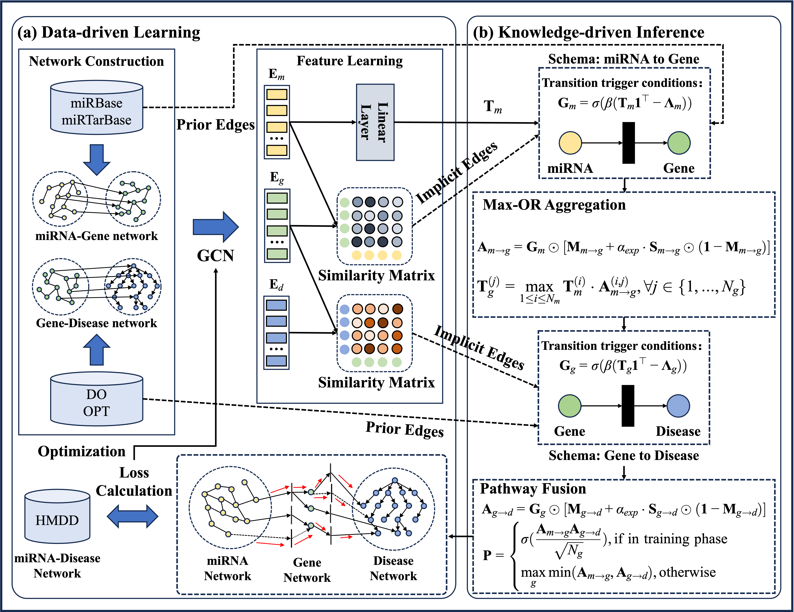

# Interpretable miRNA-Disease Association Prediction through Knowledge-Guided Graph Learning and Fuzzy Logical Reasoning

## Graphical Abstract


## Project Structure
```text
.
├── case_study.py   
├── config.py
├── config.yaml                         # parameters configurations
├── data                                # Raw and processed datasets
│   └── final
│       ├── disease_s.csv
│       ├── hmdd_combined.csv
│       ├── miR2tar_final.csv
│       ├── miRNA_s.csv
│       └── tar2dis_final.csv
├── data_load.py                       # Data loading
├── final_train_val_test_data.json     # 10-fold cross-validation indices
├── fold_data_generation.py            # 10-fold cross-validation indices generation
├── main.py
├── model.py                           # Main architecture
├── README.md
├── res
├── train_test.py                      # Model training and evaluation
└── utils.py                           
```